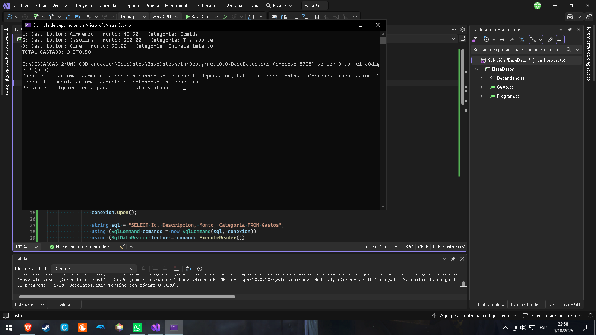
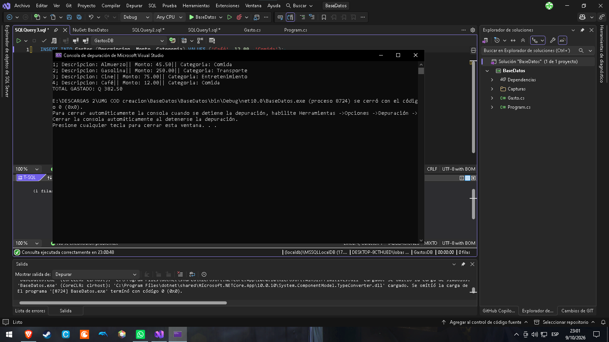
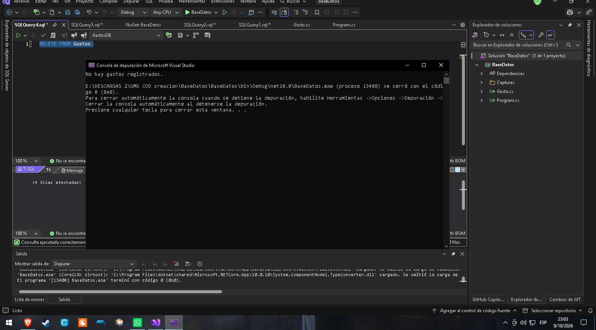
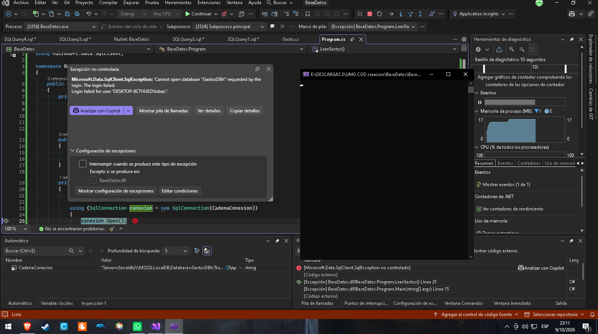

# Nombre del proyecto ||| Conexión a GastosDB

## Pasos para ejecutar el Program.cs
- | Abrir Visual Studio Community 2026
- | Ejecutar el script crear_GastosDB.sql en una nueva consulta de (localdb)\MSSQLLocalDB
- | Abrir el proyecto y presionar "F5" o "Ctrl+F5" para ejecutarlo

# Capturas

## Escenario 1

## Escenario 2

## Escenario 3

## Escenario 4: base de datos inexistente
Se cambió GastosDB por GastosDBh en la cadena de conexión.

Se lanza una SqlException porque conexion.Open() Porque intenta abrir una base de datos que no existe.
